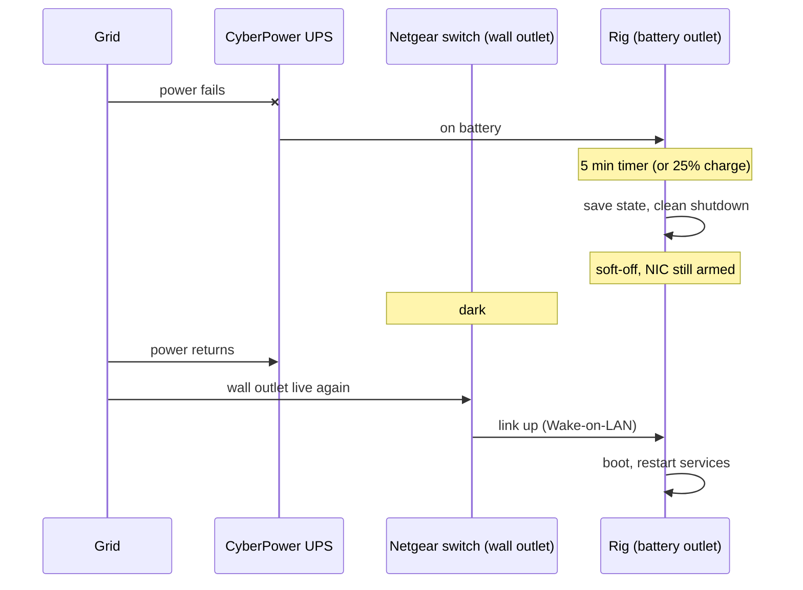

+++
date = '2026-10-12T18:29:47-04:00'
draft = true
title = 'Setting up a UPS and NUT for stable local agents'
tags = ['ai', 'experiments', 'reliability']
mermaid = true
+++

Earlier this year, I built a custom souped-up rig to run all of my AI agents at home, regardless of where I am, and without consuming resources on my own machine. It's headless, so I SSH into it as if it were a cloud-based VM.
_10 docker containers to build and test code, all at once?_ No problem. _A two hour drive to the city or to a customer site that would normally be lost productivity?_
Not even- my rig is chomping away at tasks while my Macbook lid is clammed shut and packed away.

Everything seemed perfect until accounting for upstate NY weather. Regular power outages in summer and winter storms. Downed cable.
All the things I was normally spoiled with in cloud computing went out the window. There's no such thing as **hudson-west-1a** failing over to **hudson-west-1b** zone in my house!

Speaking of which, why not use cloud computing for my dedicated AI hardware? Easy:

1. I work a lot with physical hardware: robots, IoT, _Jetson Nanos, Raspberry Pis_, etc. and I like to be able to have my development machine interface directly with them (e.g. over USB, ethernet, RS-485 serial, etc.).
2. It's cheaper. To get serious computing power on the cloud 24/7, you're paying a lot, and at the end of the day, you don't even own it. We can talk about the downsides of this another day.
3. Customizability. VM offerings in the cloud put a lot of ring fencing and restrictions around common components (and for good reason!) and don't include a lot of UI-friendly modules to give AI agents the ability to do browser-centric and OS gui-centric workflows. A custom rig with proper security can offer this easily.

But going back to the problems, I realized I needed to account for several things to make this rig reliable when away from home for several days:

- Brownouts tripping the rig
- No clean shutdown while tasks are running
- Rig not turning itself back on (not registering a power on event)
- Need surge protection
- Need to turn back on after grid power restored, without my presence (because I'm remote)
- What if the UPS deep drains?

None of this was hypothetical, by the way. In September a brownout left the board sitting there dark, with the BIOS already set to power on after AC loss.
My best guess is it never saw a real "AC loss," just a sag, and the power supply's undervoltage protection latched. I pressed the button.

So I bought a CyberPower AVR UPS (uninterruptible power supply). The headless rig runs off of it 24/7.
When there is a power outage, the UPS sends battery power to the machine, but the batteries aren't designed to power an electron hungry rig for several hours
(or even days if you are where I am, and no- running a generator for several days continuously is not an option).

The UPS is pretty intelligent (it has a USB data connection), so we compensate by detecting when grid power is lost, and sending a shut down signal to the OS.
I'm using [NUT](https://networkupstools.org/) (Network UPS Tools) on Ubuntu for this. After 5 minutes on battery (long enough to tell a real outage from a blip),
or sooner if the battery drops to 25%, the rig gracefully stops all of its services (AI and otherwise) and powers down.
Every event gets logged along with the charge, runtime and input voltage, so I can do a post-mortem from the road.



Coming back is the harder half. The rig is attached to a Netgear managed ethernet switch, which is critically NOT on the UPS at all, just its own surge protector at the wall.
So when power is restored, the switch boots, the link to the rig comes up, and the rig's network port treats that as a Wake-on-LAN signal.
The rig powers itself on, and brings its services back up on boot.
If the outage goes on long enough to actually drain the UPS, the UPS should switch itself off, switch itself back on when the grid returns, and the BIOS boots the rig the old fashioned way
(I say "should" because I haven't left the plug out overnight to prove it yet).
Either way, nobody has to be home.

This is actually the second design. The first one did what NUT does out of the box: after the OS halts, tell the UPS to cut its outlets, then re-power them when the grid returns.
CyberPower units don't do that. Give it a restart timer and it re-powers the outlets when the timer runs out whether the grid is back or not, so the rig boots straight into the outage on battery and loops.
Give it no timer and it never comes back, not even when the grid does (I tested this twice, waiting 25 minutes each time). Someone has to walk over and press the button, which is the exact thing I was trying to get rid of.
A CyberPower support statement, quoted right in the NUT man page, says that at least some of their models "are unable to set up power on delay." Hence the switch trick: leave the UPS running, and wake the machine from the network side instead.

The source code is available here for your use: [github.com/kristophM/ups-agent](https://github.com/kristophM/ups-agent).
It's an installer- clone it on the box, run `sudo ./install.sh`, and it takes care of NUT, the config, arming Wake-on-LAN and the logging. Re-run it to change settings.
